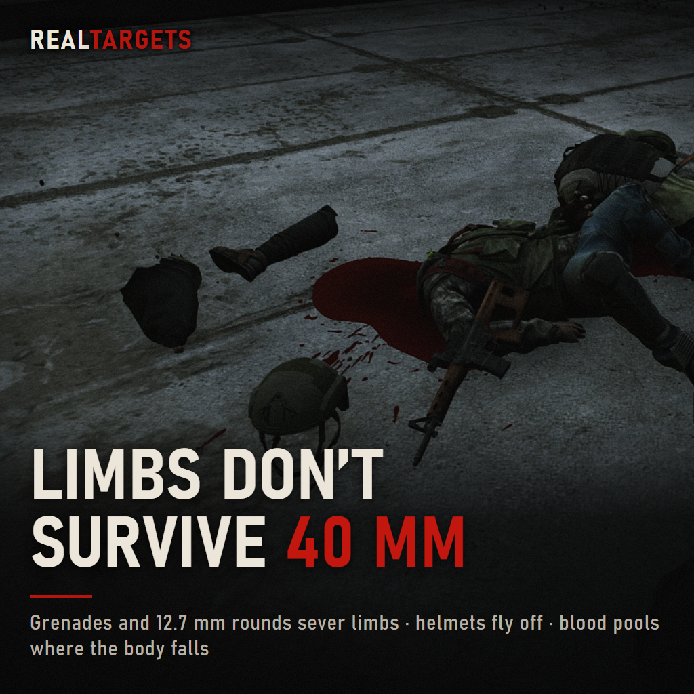
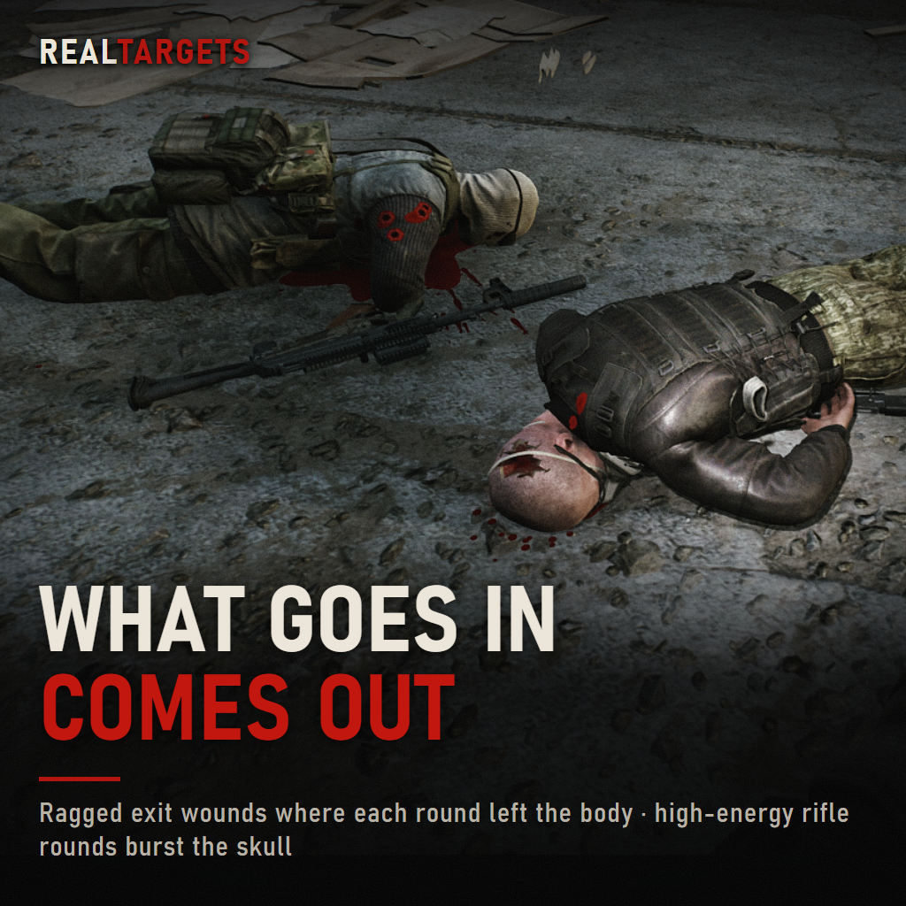
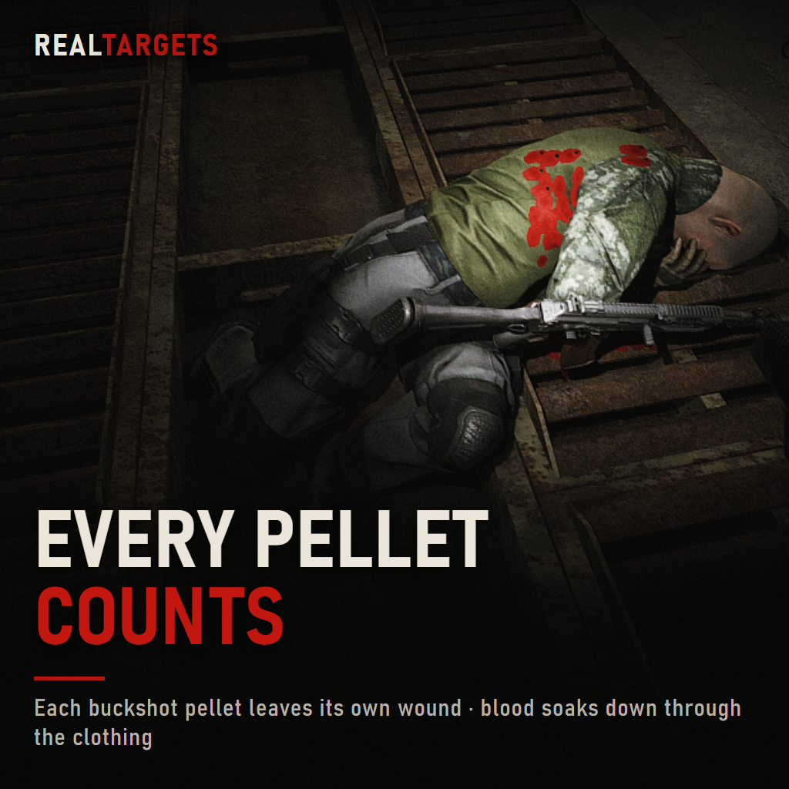
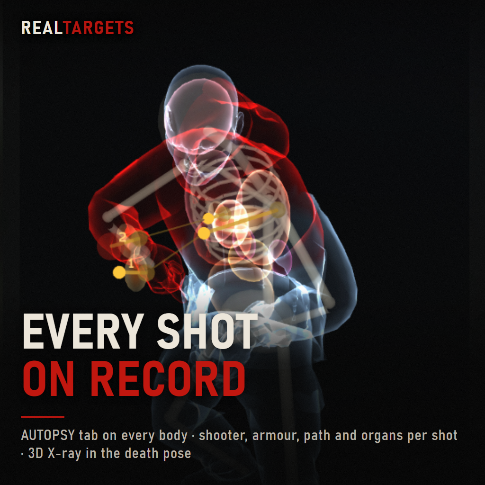
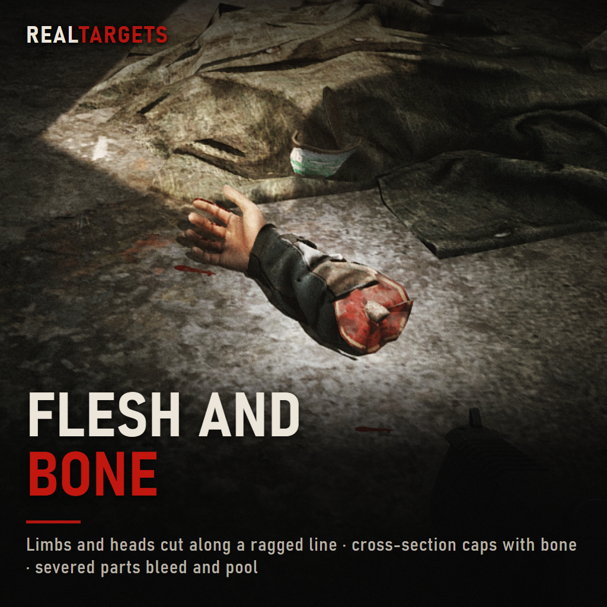
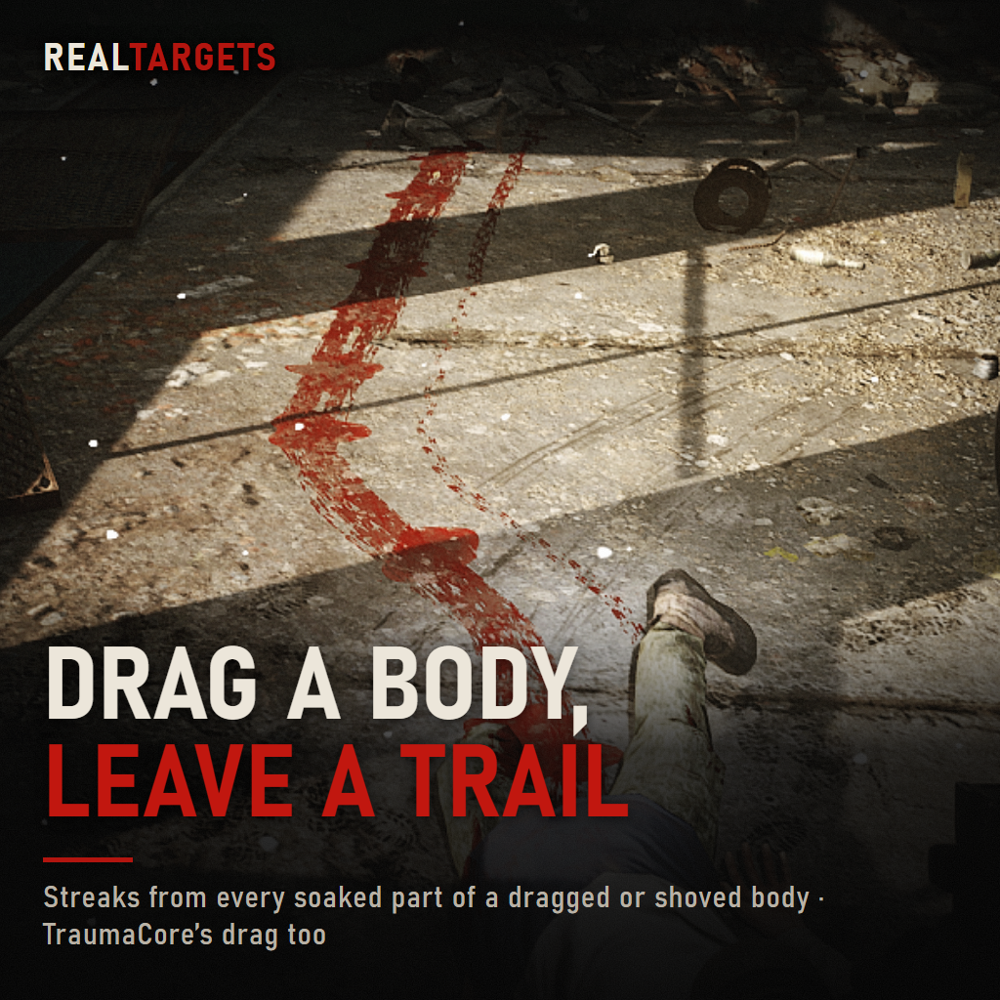
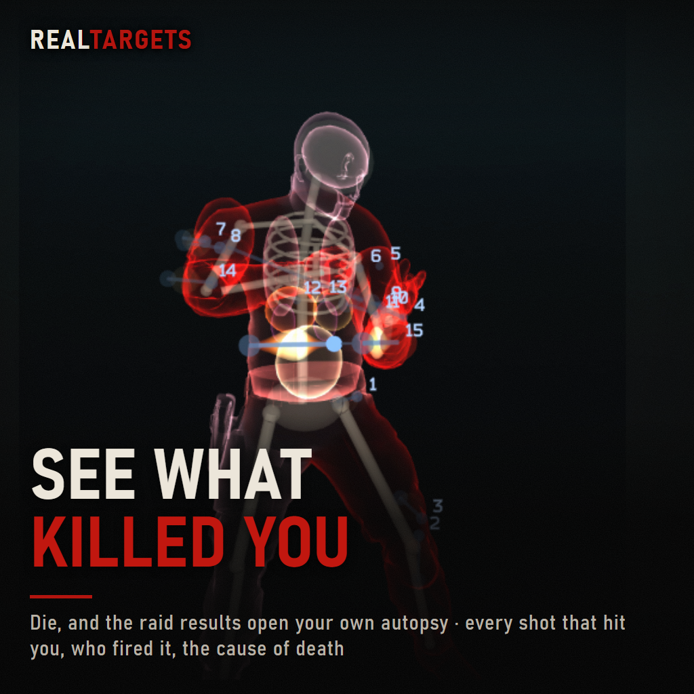

# RealTargets

Realistic blood, wounds and gore for SPT (Single Player Tarkov). Every bullet that enters a body leaves a mark
that follows real ballistics: where it went in, where it came out, how much energy it carried and what was
behind the target.

Purely visual: damage, bleeding HP loss, death and AI stay vanilla EFT (and SAIN, if installed).

**Download:** [The Forge](https://sp-mod.com/mod/3165/realtargets) or [GitHub Releases](https://github.com/St0mpa/RealTargets/releases).

<p>
  
  
  
</p>
<p>
  
  
  
  
</p>

## Features
- **Entry and exit wounds** on clothing and skin, placed where each round actually went through. Exits are
  bigger and ragged, scaled by the bullet's energy.
- **Bleeding per wound**: drips, blood running down the clothing, and spurts when a big artery is hit (neck, groin,
  thigh, upper arm). Heartbeat-paced, fading out over the last beats after death, then draining by gravity.
- **Exit spray, blood mist and wall spatter** on whatever stands behind a through-shot.
- **Pools** under bodies, sized by the blood that ran out, drying darker over time. **Bloody footprints** from
  anyone who walks through a wet pool.
- **Entries by surface**: a wound on skin, a dark puncture on cloth, and on armour and gear the game's own hole.
  Rounds that go through one part into the next (forearm into the chest) wound and bleed in both.
- **Dismemberment**, cut out of the body along a ragged line with a cross-section of flesh and bone:
  - Heads come apart from close-range buckshot, slugs, 12.7 mm and similar, and grenades at very close range.
  - High-energy rifle rounds (7.62x51, 7.62x54R and others) burst the skull open at the exit, following the head.
  - Repeated hits on a dead body's head add up.
  - Limbs come off from 12.7 mm rifle/MG rounds and grenades, also when the hit is what kills.
  - Severed limbs bleed and pool. Gibs fly, stick to walls and slide down them. Helmets get thrown off.
- **Drag smears**: a dragged or shoved body leaves striped streaks from every soaked part (TraumaCore's drag too).
- **AUTOPSY tab** next to LOOT on every body: each shot that hit it (shooter, weapon, ammo, distance, armour and what it
  did, damage, path through the body, organs), the killing shot or cause of death, health at death, and a 3D X-ray of the
  body in its death pose with skeleton, organ zones, wound channels and the temporary cavity.
- **Death screen**: when you die, your PMC on the raid results shows what hit you, wounds, blood and a lost head or
  limbs by the same rules. An **AUTOPSY** button (or X) switches to the autopsy of your own death: the X-ray in your
  death pose, every shot and who fired it, the cause of death and your health at death.
- **Corpse impacts**: bullets push dead bodies by their momentum, and grenade blasts throw nearby corpses.
- No blood on doors, windows or other moving objects, so nothing hangs in mid-air when a door opens.
- Lit by the map's own lighting: dark in dark rooms, wet sheen in the light.

## Install
1. Install SPT 4.1.6.
2. Extract the zip into your SPT folder (the one with `EscapeFromTarkov.exe`). You should end up with
   `BepInEx/plugins/RealTargets/RealTargets.dll`.
3. Start the game. The config file `BepInEx/config/com.stompa.realtargets.cfg` is created on the first run.

Uninstall: delete the `BepInEx/plugins/RealTargets` folder (and the config file if you like).

## Configuration
Press **F12** in game (SPT's Configuration Manager) and open **stompa-RealTargets**. Every effect can be
switched off on its own, and the thresholds can be tuned:
- **General / Enabled**: master switch.
- **Blood**: blood volume, bleed rate, arterial chance, the last heartbeats after death, how long corpses keep draining.
- **Visuals**: each blood effect on or off, decal shader, max distance (80 m).
- **Gore**: dismemberment and gibs on or off. Energy thresholds for heads, skull bursts and limbs. Shotgun range
  and how many pellets must hit the head. Gore only: turn **Visuals / Enabled** off and keep Gore on.
- **Autopsy**: the AUTOPSY tab on or off, only your own shots, the 3D skeleton, organ zones and cavities.
- **Death screen**: your wounded PMC on the raid results, whose report shows (RealTargets, TraumaCore or both) and
  the autopsy key (X).
- **Impacts**: corpse pushes and blast throws.
- **HollywoodFX / Prefer its blood** (only with HollywoodFX): let its blood replace ours at the moment of the hit.
- **Hit model**: armour stop threshold, energy thresholds, temporary cavity size.
- **Flinch** (off by default): living bots flinch per limb through EFT's own hit-reaction rig.
- **Debug**: log hits, blood and wound placement to the BepInEx log (all off by default; turn on for a bug report).

## Compatibility
- **SPT 4.1.6** (tested; later 4.1.x patches should work). Client-only: no server mod.
- **Dependencies**: none beyond SPT.
- **Tested together** (the author's own install):
  - **HollywoodFX 3.0.0** (with HollywoodGraphics): works. Both add blood, but they complement each other:
    RealTargets does the realistic layer (wounds, bleeding, pools, dismemberment), HollywoodFX its cinematic sprays
    and splatter on top. Run both at defaults. Both also push corpses when shot; if bodies move more than you like,
    lower HollywoodFX's `Ragdoll Force Multiplier` or RealTargets' `Impacts > Push strength`.
  - **Ragdoll Kinetics**: works. Keep RealTargets' Flinch off with it (the default): the two reactions stack into an
    over-the-top one.
  - **TraumaCore 1.7.0**: works. Both draw a report on the death screen; by default RealTargets shows its own and
    hides TraumaCore's (**Death screen > Report** = TraumaCore or Both to change that). With HollywoodFX, turn
    TraumaCore's Procedural World Blood off (it draws red squares then, and RealTargets already draws the blood).
  - **SAIN**, BigBrain, UI Fixes, LootNet, AmandsSense, Dynamic Maps: no conflicts.
- **Fika is not supported.**
- Tried it with another mod? Say so on the [Forge page](https://sp-mod.com/mod/3165/realtargets), works or not.
- Performance: the mod's own CPU time averages about 0.1 ms per frame in a busy raid. Blood marks, pools and
  gore pieces have fixed caps, so a long raid doesn't pile them up.

## Building from source
Requires the .NET SDK (8 or newer) and an SPT 4.1.x install. Game assemblies are referenced in place from the
install and are not part of this repository.
```
dotnet build src/RealTargets.Client/RealTargets.Client.csproj -c Public -p:SptDir="C:\path\to\SPT"
dotnet build src/RealTargets.Client/RealTargets.Client.csproj -c Public -p:SptDir="C:\path\to\SPT" -p:Package=true
```
The first builds `bin/Public/RealTargets.dll`. The second also writes the install-ready zip to `dist/`.

## Credits
- Built on [SPT](https://sp-tarkov.com), [BepInEx](https://github.com/BepInEx/BepInEx) and
  [Harmony](https://github.com/pardeike/Harmony).

## License
MIT, see `LICENSE`. Copyright (c) 2026 Stompa.

## Support
Bug reports: the comments on the [Forge page](https://sp-mod.com/mod/3165/realtargets). Include your
`BepInEx/LogOutput.log` with the Debug logs turned on.
